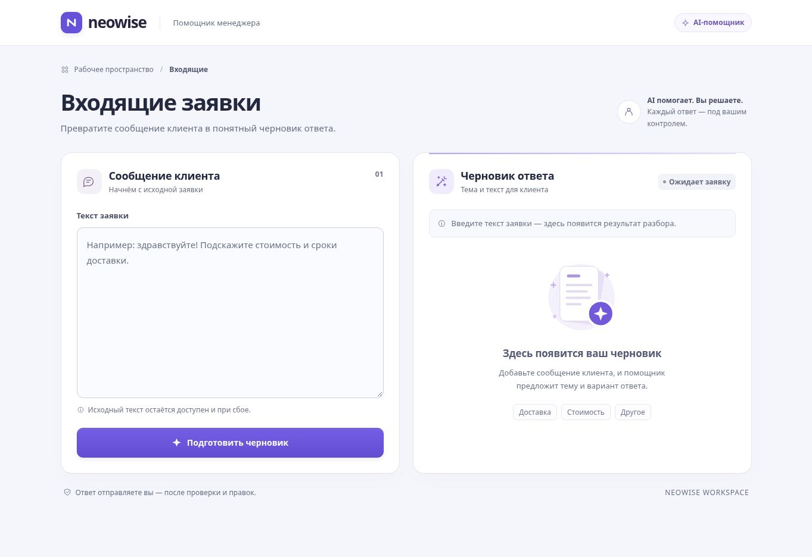
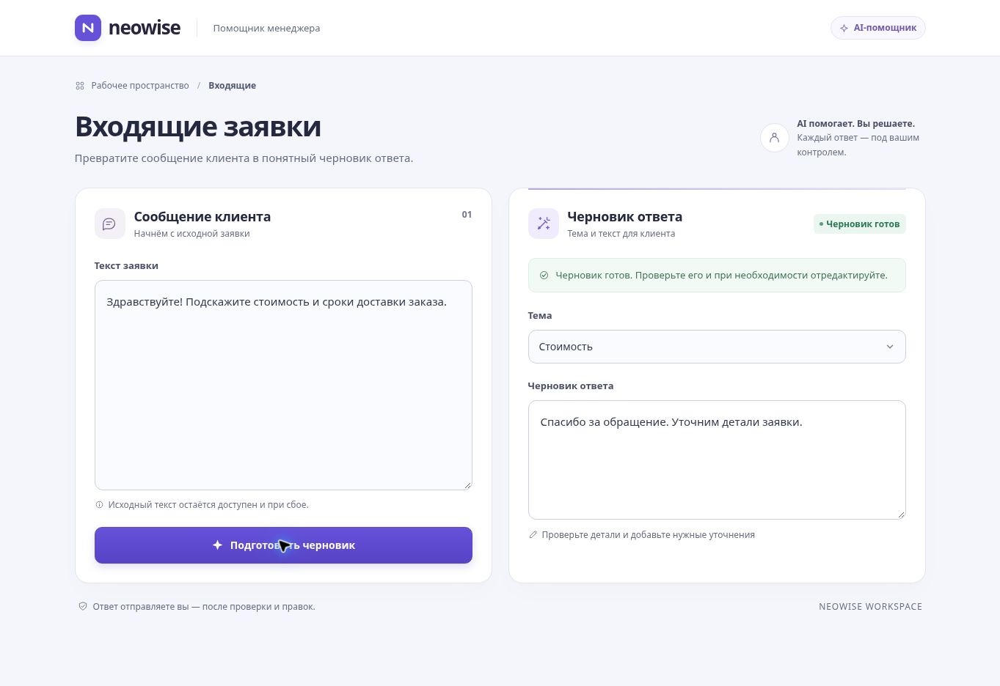
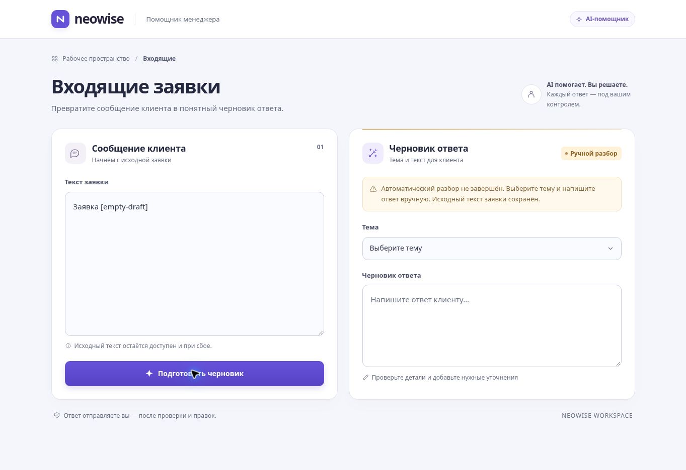

# Тестовое Neowise. AI-помощник для входящих заявок

Ориентир — 45–60 минут. Менеджер вводит текст заявки, получает тему и черновик ответа. Он читает результат и сам решает, что отправить клиенту.

## Запуск

В репозитории есть сервер, HTML-страница и имитатор модели. Нужен Node.js 20 или новее. Зависимостей и ключей нет.

```sh
node server.mjs
```

Откройте http://127.0.0.1:3000. Порт можно задать через переменную `PORT`.

## Что изменить

1. Доработайте `POST /api/triage`. Принимайте JSON с полем `text`, содержащим непустую строку. При пустом, отсутствующем, нестроковом вводе или битом JSON верните HTTP 400 и `{"status":"invalid_input"}`.
2. При корректном ответе модели верните HTTP 200 и `{"status":"ready","topic":"…","draft":"…"}`. Допустимые темы — `delivery`, `pricing`, `other`. Черновик должен быть непустой строкой. При таймауте, ошибке модели или неподходящем ответе верните HTTP 200 и `{"status":"manual_review","topic":null,"draft":null}`. Ограничьте ожидание модели 300 мс. Оставьте поведение выданного имитатора прежним.
3. Покажите на странице тему и черновик при успехе. Для `manual_review` покажите понятное сообщение менеджеру и очистите предыдущий черновик. Добавьте хотя бы один исполнимый тест для поведения при сбое и инструкцию его запуска.

Для локальной проверки имитатор принимает любой обычный текст. Метки `[timeout]`, `[error]`, `[bad-json]`, `[bad-topic]`, `[empty-draft]` включают отдельные сценарии сбоя.

## Что прислать в бота

- Ссылку на pull request и SHA проверяемого коммита. Можно использовать свой учебный репозиторий. Сохраните начальный код первым коммитом, затем откройте PR из отдельной ветки.
- Короткую инструкцию запуска и прогона теста. В описании PR ответьте, где проверяется результат AI, что происходит при сбое, какой AI вы использовали и что проверили самостоятельно. Если работали без AI, укажите это.
- Одну фразу о том, какую пользу задача даёт менеджеру и как её можно измерить.

После сдачи бот может задать один-два коротких вопроса по вашему коду. Используйте учебные данные. Если не уложились по времени, отметьте незавершённые части в PR.


---

## Реализованное решение

Запуск и тесты не требуют установки пакетов, ключей API или доступа в интернет.
Нужен Node.js 20+; проверка этой версии решения выполнена на Node.js 24.22.3.

```sh
node server.mjs
```

Откройте `http://127.0.0.1:3000`. В другом терминале из каталога проекта:

```sh
node --test
```

Тестовый сервер использует случайный свободный порт, поэтому не мешает уже запущенному приложению.

### Контракт API

| Условие | HTTP | Тело ответа |
| --- | --- | --- |
| Битый JSON; отсутствующий, нестроковый, пустой или пробельный `text` | 400 | `{"status":"invalid_input"}` |
| Корректные тема и черновик | 200 | `{"status":"ready","topic":"delivery / pricing / other","draft":"Непустой текст"}` |
| Таймаут, исключение модели, битый JSON или неподходящие поля ответа | 200 | `{"status":"manual_review","topic":null,"draft":null}` |

В успешном ответе `topic` содержит **одно** из значений `delivery`, `pricing`, `other`.

### Где проверяется AI

- `server.mjs`: до обращения к имитатору проверяется входной JSON и непустой строковый `text`.
- После вызова модели отдельно проверяются JSON-объект, допустимая тема и строковый черновик после `trim()`.
- Поля ответа собираются явно: лишние поля модели, в том числе её собственный `status`, не попадают в API.
- `Promise.race` ограничивает ожидание модели 300 мс; `AbortController` отменяет штатный имитатор, таймер очищается в `finally`. Дедлайн действует и для асинхронного провайдера, который не поддерживает отмену. HTTP-обмен добавляет небольшой накладной расход к этим 300 мс.
- `mock-ai.mjs` оставлен побайтно без изменений. Реальная модель в приложении не вызывается.

### Что происходит на странице

Интерфейс оформлен как рабочее пространство с двумя панелями: исходная заявка и черновик ответа. Для ожидания показана иллюстрация, для успеха и ручного разбора — отдельные цветовые состояния с иконкой и текстом. На узком экране панели располагаются друг под другом. Разметка, стили и SVG находятся в `index.html`; внешних ресурсов для оформления не требуется.

`app.mjs` управляет состояниями формы: `idle`, `loading`, `ready`, `invalid_input`, `manual_review`.

При успешном разборе менеджер получает тему и редактируемый черновик. При сбое он видит сообщение о ручном разборе, выбирает тему и пишет ответ сам. Предыдущие тема и черновик очищаются, исходная заявка остаётся в поле ввода. Отправки сообщений клиентам в приложении нет.

Пустой ввод объясняется сразу и не вызывает API. Сетевой сбой, непригодный ответ API и клиентский таймаут тоже приводят к ручному разбору. Клиентский предел 5 секунд покрывает получение ответа и чтение JSON; он отдельный от серверного дедлайна модели 300 мс.

При повторном запуске учитывается только последний отправленный запрос. Возрастающая версия и отмена защищают результат, сообщение об ошибке и состояние загрузки от устаревших ответов. Изменение исходного текста также делает предыдущий запрос неактуальным. Данные выводятся через `textContent` и `.value`.

### Проверки

`test/api.test.mjs` проверяет реальные HTTP-запросы к серверу: неверный ввод без вызова AI, три темы, все пять меток имитатора, неправильную схему результата, дедлайн, отмену и позднюю ошибку провайдера.

`test/ui.test.mjs` проверяет контроллер интерфейса: очистку старого черновика, ошибки сети/API, клиентский дедлайн, обратный порядок ответов, устаревшие ошибки и сброс состояния после изменения исходного текста. Для гонок порядок ответов задаётся управляемыми Promise.

В ходе подготовки выполнены 52 автоматические проверки: все прошли. Реальный `[timeout]` возвратил `manual_review` примерно за 304 мс с учётом локального HTTP-обмена. Этот замер относится к данному запуску, а не к гарантии задержки всей сети.

После обновления интерфейса приложение запущено вместе с API и повторно проверено в Chromium через настоящую страницу: **13 браузерных сценариев прошли**. Проверка выполнена через ввод текста, нажатия кнопки, выбор темы и редактирование черновика.

| Сценарии | Проверенный результат |
| --- | --- |
| Три обычные заявки: доставка, стоимость, другое | Правильная тема и непустой редактируемый черновик |
| Пустая строка и строка из пробелов | Понятная ошибка ввода, пустые тема и черновик |
| Все пять меток сбоя; перед каждой получен успешный черновик | Ручной разбор, старые тема и черновик очищены, исходный текст сохранён |
| Ручное заполнение после сбоя | Можно выбрать тему и написать ответ, исходная заявка остаётся доступной |
| Обычная заявка после сбоя | Форма возвращается к успешному результату |
| Новая заявка, пока предыдущий запрос ещё в состоянии `loading` | На странице сохраняется результат новой заявки |

Обратный порядок завершения ответов отдельно проверен детерминированными тестами контроллера с управляемыми Promise. Браузерный прогон дополняет их проверкой настоящей формы и HTTP API.

Дополнительно проверена адаптивная вёрстка в браузерном iframe шириной 390 пикселей: обычная заявка, переход к ручному разбору, очистка старого черновика и ручное редактирование. Горизонтального переполнения нет.

<details>
<summary>Скриншоты браузерной проверки</summary>

Начальное состояние обновлённого интерфейса:



Успешный разбор:



Сбой имитатора: исходная заявка сохранена, старый черновик очищен, доступен ручной разбор:



</details>

#### Как повторить проверку в браузере

1. Запустите сервер и введите «Когда доставка?». Должны появиться тема «Доставка» и непустой черновик.
2. Введите новую заявку с `[error]`, затем повторите с `[timeout]`, `[bad-json]`, `[bad-topic]`, `[empty-draft]`.
3. В каждом случае ожидаются «Ручной разбор», пустые поля темы и черновика, сохранённый исходный текст. Проверьте, что тему и ответ можно заполнить вручную.
4. Отправьте пробельный ввод: появится просьба ввести текст.
5. Повторите обычный запрос: форма должна вернуться к успешному результату.

### Использование AI

Использован ChatGPT с AI-агентами для разбора задания, реализации, ревью, подготовки и запуска тестов, а также проверки приложения через браузер. Все перечисленные автоматические проверки и браузерные сценарии действительно выполнены в ходе работы ассистента; шаги для повторения приведены выше.

### Польза для менеджера

Менеджер получает заготовку ответа, а при сбое продолжает ручную обработку исходной заявки с очищенным черновиком. Эффект можно измерять по ручному времени на заявку с учётом проверки и исправлений, доле готовых черновиков без правок и числу случаев ручного разбора; фактические улучшения на реальном потоке здесь не измерялись.
